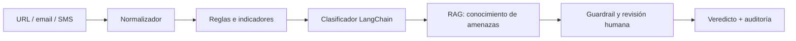

# Flujos de IA y LangChain/LangFlow

## Estado de laboratorio

La aplicación incluye un endpoint `/api/v1/ai/status` y una pantalla de IA que documentan los módulos y guardrails. El detector activo del MVP es determinista y seguro: no navega URLs, no ejecuta adjuntos y no permite acciones críticas automáticas.

## Flujo propuesto para LangChain



Prompt base recomendado:

```text
Eres un analista SOC bancario. Analiza únicamente la evidencia proporcionada.
No inventes reputación, WHOIS, DNS ni certificados. Devuelve JSON con:
score, verdict, indicators, confidence, rationale y recommended_action.
No ejecutes acciones externas ni abras la URL.
```

Herramientas permitidas: consulta de indicadores internos, búsqueda de documentos RAG y cálculo de rasgos locales. Acciones de contención requieren aprobación humana y RBAC.

## Flujo LangFlow

El grafo visual debe contener: entrada estructurada → normalización → prompt template → modelo Ollama/OpenAI/Azure → parser JSON → validador Pydantic → registro de auditoría. Configurar variables y secretos fuera del JSON exportado.

## Modelos

- Ollama para desarrollo sin enviar datos fuera del banco.
- Azure OpenAI/OpenAI solo con clasificación de datos, retención y contrato aprobados.
- Fallback determinista del MVP cuando no hay proveedor configurado.
