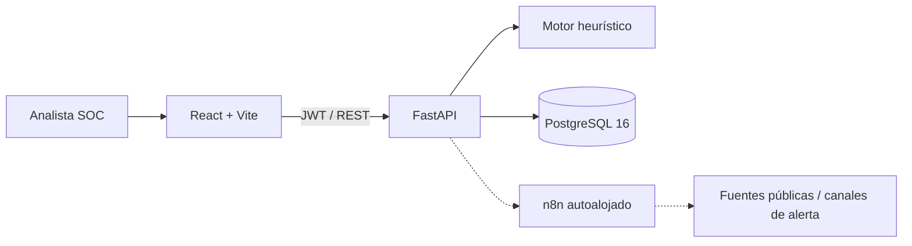
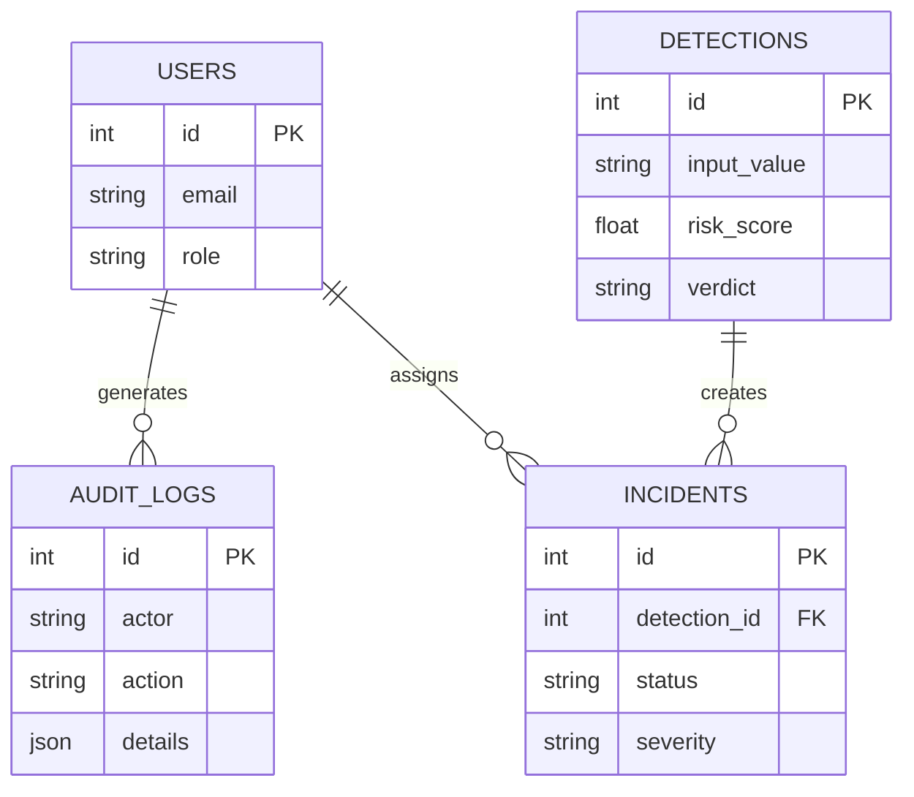
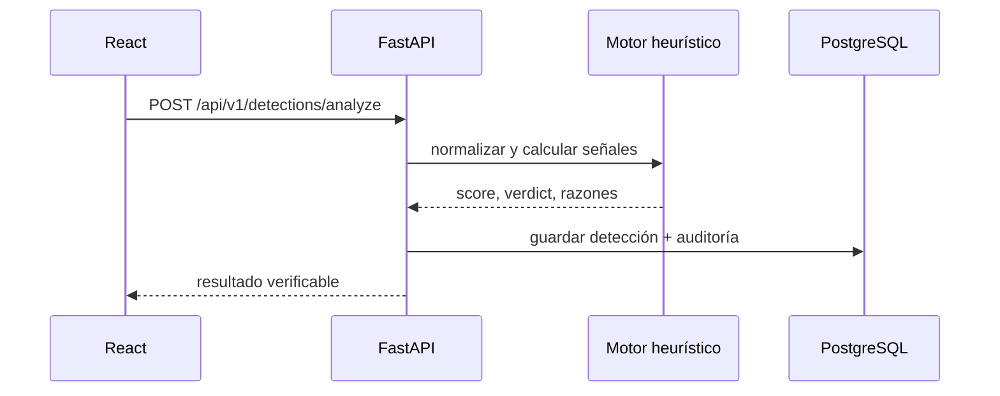

# Arquitectura de referencia

## Alcance del MVP

Esta implementación es una base funcional defensiva: autentica usuarios, analiza contenido sin navegar ni descargar URLs, guarda detecciones y expone métricas. No reemplaza un sandbox, un feed comercial ni un proceso bancario de producción.

## Seguridad

- La contraseña demo se crea como hash PBKDF2; en producción se recomienda Argon2id, MFA y SSO.
- El analizador no realiza requests a la URL recibida, reduciendo SSRF en el MVP.
- JWT, CORS limitado, validación Pydantic y auditoría de operaciones sensibles.
- Cambiar `JWT_SECRET` antes de cualquier despliegue real.

## Modelo de datos

## Flujo de detección

## Dataset y ETL

El workflow de n8n incluido deja documentada la ingesta programada de PhishTank. Antes de usarlo en un entorno real, verifica licencia, términos vigentes, formato disponible, rate limits y autorización para almacenar los indicadores. La importación debe añadir `source`, `retrieved_at`, versión del lote, checksum y estado de validación.

## Extensiones recomendadas

Para v1: Alembic, refresh-token rotation, Argon2id, rate limiting, endpoint de alertas, integración STIX/TAXII y tests de integración. Para v2: workers, RAG con controles de prompt injection, sandbox aislado, Kubernetes y evidencias regulatorias.
